# 十五画境·AI 动画手艺书

**想要一段片头动画、知识讲解动画，不会 AE、不想套模板的，把它丢给你的 AI。**

它教 AI 用代码做 MG 动画短片：15 种动态设计风格，每种都写清楚了一眼认出它靠什么、画面怎么摆、10 秒的节奏怎么排、最容易做成「不像」的地方在哪。AI 读完按你的主题自己写画面和配乐，导出带声音的 MP4。每次都是新片子，不是换字的模板。

<p align="center"><a href="https://liuhaisi2026212-maker.github.io/motion-palette-15/">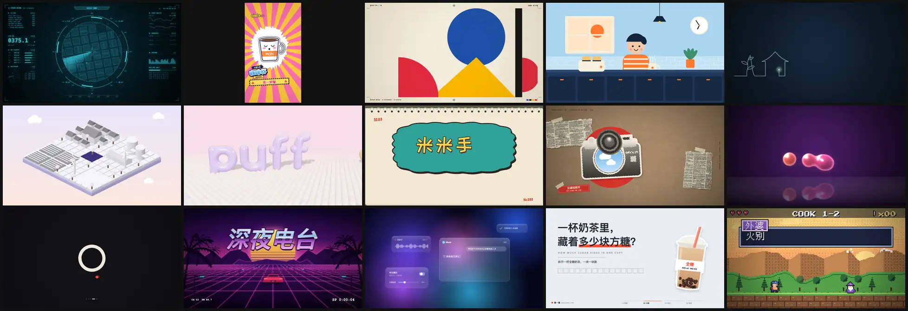</a></p>

<p align="center"><a href="https://liuhaisi2026212-maker.github.io/motion-palette-15/"><b>▶ 带声音看 15 支样片</b></a> · <a href="https://github.com/liuhaisi2026212-maker/motion-palette-15/releases">下载原画质</a></p>

上面 15 支都是 AI 照着这本手艺书写代码做出来的：画面、动画、配乐全是代码，没有用生图或生视频模型。

## 30 秒装上

```bash
npx -y skills add liuhaisi2026212-maker/motion-palette-15 -g --all
```

装好后跟你的 AI 说一句「用十五画境做一个 10 秒的片头，主题是……」就行。支持 Claude Code、Codex、Cursor 等能装技能、能运行代码的智能体。

- **手动安装**：到 [Releases](https://github.com/liuhaisi2026212-maker/motion-palette-15/releases) 下载 `shiwu-huajing-*.zip`，解压出的 `shiwu-huajing` 文件夹放进 `~/.claude/skills/`（Claude Code）或 `~/.codex/skills/`（Codex）。
- **用豆包、DeepSeek、Kimi 这类只能聊天的**：把 [`SKILL.md`](skills/shiwu-huajing/SKILL.md)、[`05-一般模型怎么做.md`](skills/shiwu-huajing/references/05-一般模型怎么做.md) 和你要的那张[风格卡](skills/shiwu-huajing/references/styles/)一起上传，它会写出完整代码；你把代码放进 `starter/`，双击启动器预览、导出。

## 做一次给你看

**你说：**

> 用十五画境做一个 10 秒的赛博 HUD 片头，主题是「帮主人找走丢的猫」。

**AI 先读赛博 HUD 的风格卡，再写节拍表**（还不写代码）：

| 秒 | 画面 | 声音 |
|---|---|---|
| 0～0.7 | 一条亮线上下展开开机，外框、瞄准镜圆环依次画出 | 低频嗡声、重击 |
| 0.4～2.4 | 左列自检日志逐行打出，右列面板出现，街区地图从上往下扫出来 | 每行一声短哔 |
| 2.4～4.4 | 数字开始乱跳、雷达 2 秒扫一圈 | 120 BPM 底鼓进来 |
| 4.4～5.9 | 发现信号；候选比对：NO MATCH、NO MATCH、**MATCH 99.7%** | 两声高音提示 |
| **6.4** | 全屏从青色硬切琥珀色，横向锁定带「目标锁定 / LOCKED」，冲击波扩散 | 重击 + 双音警报 |
| 6.4～9.4 | 镜头俯冲放大到猫的位置，坐标框弹出，数据上传走满 | 上行琶音 |
| 9.8～10 | 画面收成一条线关机 | 下滑音 |

**然后写代码、逐帧渲染、抽帧自查、导出 MP4。** 成片：

<p align="center">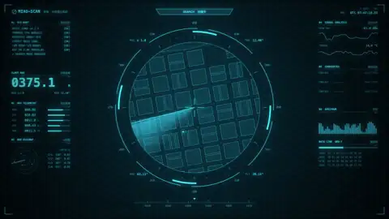</p>

它还会交代：用了哪些风格卡上的必备元素、各在哪一秒，字体、图片、音乐的来源，以及哪里还不够好。

## 能做到什么程度

| 你的情况 | 能做到 |
|---|---|
| 强模型（Claude、GPT 一档）+ 能运行代码的智能体 | 上面样片的水平。样片每支都经过 2～3 轮「抽帧看图 → 对照风格卡改」，一次出来通常还差一口气，多让它自查几轮 |
| 一般模型 + 能运行代码 | 照「最小可行做法」只用 2～3 个手法，做出干净、认得出风格的短片；细节和镜头会比样片简单。**这一档还在实测中** |
| 只能聊天的平台 | 给你完整代码，预览、导出要你在电脑上点一下；它看不到画面，改错要靠你截图反馈 |

**做不了的：** 真人实拍和写实人物、口型同步、照片级写实 3D、几分钟的长片（建议 8～20 秒一支）。它擅长的是片头、转场、知识讲解、产品亮点这类图形动画。

**需要的环境：** 预览和导出要 Chrome 或 Edge，加 Node.js 或 Python 其中一个；命令行批量渲染要 ffmpeg。

## 15 种风格

<table>
<tr>
<td align="center" width="33%"><br><b>赛博 HUD</b> · 寻猫雷达<br><sub>满屏信息，一个焦点，全为「锁定」蓄力</sub><br><sub><a href="skills/shiwu-huajing/references/styles/hud.md">风格卡</a> · <a href="skills/shiwu-huajing/examples/films/hud-寻猫雷达/">源码</a></sub></td>
<td align="center" width="33%">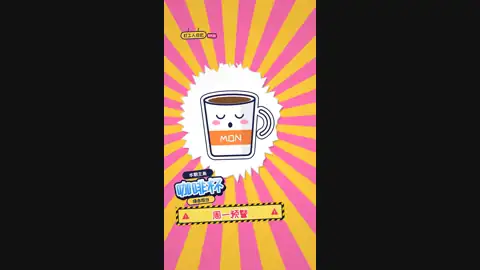<br><b>综艺花字（竖屏）</b> · 周一早上<br><sub>贴纸描边大字、放射背景、表情包吐槽</sub><br><sub><a href="skills/shiwu-huajing/references/styles/variety-captions.md">风格卡</a> · <a href="skills/shiwu-huajing/examples/films/variety-周一早上/">源码</a></sub></td>
<td align="center" width="33%">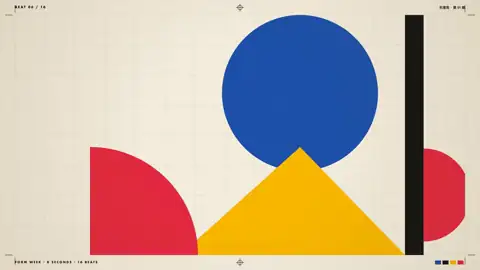<br><b>包豪斯</b> · 形意周<br><sub>几何色块出血、印刷标记、图案爆发</sub><br><sub><a href="skills/shiwu-huajing/references/styles/bauhaus.md">风格卡</a> · <a href="skills/shiwu-huajing/examples/films/bauhaus-形意周/">源码</a></sub></td>
</tr>
<tr>
<td align="center">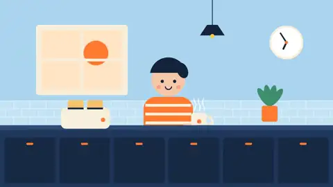<br><b>扁平矢量</b> · 早一点<br><sub>无描边色块，一个小橙点串起转场</sub><br><sub><a href="skills/shiwu-huajing/references/styles/flat-vector.md">风格卡</a> · <a href="skills/shiwu-huajing/examples/films/flat-vector-早一点/">源码</a></sub></td>
<td align="center"><br><b>线条一笔画</b> · 山间茶事<br><sub>一根线不断开，画完一个故事</sub><br><sub><a href="skills/shiwu-huajing/references/styles/line-art.md">风格卡</a> · <a href="skills/shiwu-huajing/examples/films/line-art-山间茶事/">源码</a></sub></td>
<td align="center">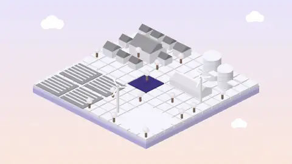<br><b>等轴 2.5D</b> · 一亩田<br><sub>沙盘升起、白模生长、颜色从中心铺开</sub><br><sub><a href="skills/shiwu-huajing/references/styles/isometric.md">风格卡</a> · <a href="skills/shiwu-huajing/examples/films/isometric-一亩田/">源码</a></sub></td>
</tr>
<tr>
<td align="center">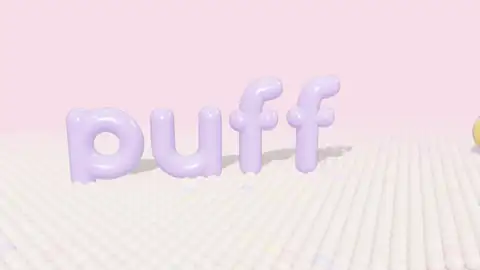<br><b>3D 软萌</b> · 泡芙工作室<br><sub>充气字落地回弹、珠子地面起波纹</sub><br><sub><a href="skills/shiwu-huajing/references/styles/3d-render.md">风格卡</a> · <a href="skills/shiwu-huajing/examples/films/3d-render-泡芙工作室/">源码</a></sub></td>
<td align="center">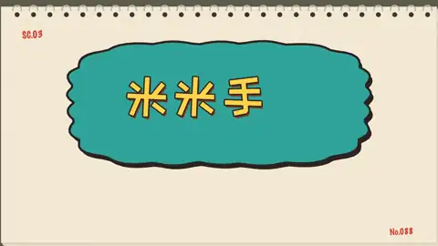<br><b>逐帧手绘</b> · 米米手作<br><sub>每两帧抖一次的线、一笔一笔写的字</sub><br><sub><a href="skills/shiwu-huajing/references/styles/cel-boil.md">风格卡</a> · <a href="skills/shiwu-huajing/examples/films/cel-boil-米米手作/">源码</a></sub></td>
<td align="center">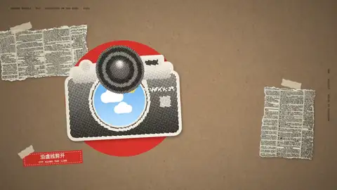<br><b>拼贴</b> · 漫游周刊<br><sub>网点剪报、沿虚线剪开、撕纸转场</sub><br><sub><a href="skills/shiwu-huajing/references/styles/collage.md">风格卡</a> · <a href="skills/shiwu-huajing/examples/films/collage-漫游周刊/">源码</a></sub></td>
</tr>
<tr>
<td align="center">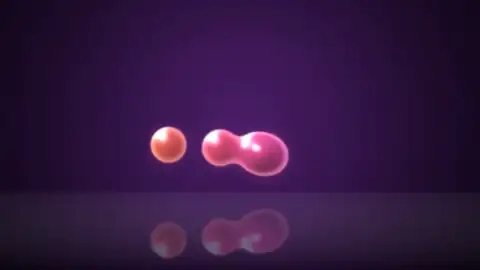<br><b>液态</b> · 啵啵果饮<br><sub>水滴溅开、分裂、融成果冻字</sub><br><sub><a href="skills/shiwu-huajing/references/styles/liquid.md">风格卡</a> · <a href="skills/shiwu-huajing/examples/films/liquid-啵啵果饮/">源码</a></sub></td>
<td align="center">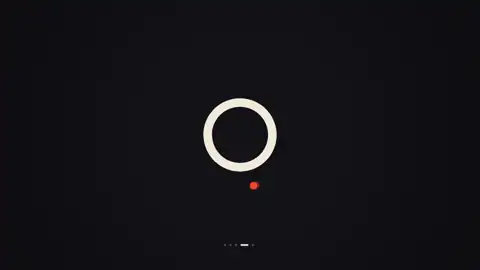<br><b>形变</b> · nova.<br><sub>点变线、线变圈、圈变字母</sub><br><sub><a href="skills/shiwu-huajing/references/styles/morph.md">风格卡</a> · <a href="skills/shiwu-huajing/examples/films/morph-nova/">源码</a></sub></td>
<td align="center">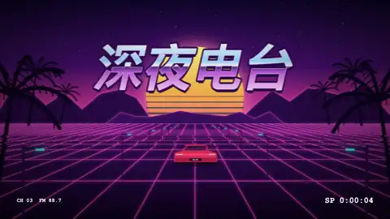<br><b>复古霓虹 VHS</b> · 深夜电台<br><sub>录像带界面、霓虹网格、铬金大字</sub><br><sub><a href="skills/shiwu-huajing/references/styles/synthwave.md">风格卡</a> · <a href="skills/shiwu-huajing/examples/films/synthwave-深夜电台/">源码</a></sub></td>
</tr>
<tr>
<td align="center">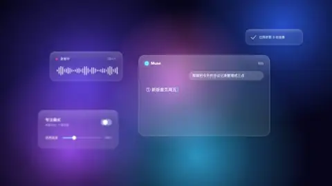<br><b>弥散玻璃</b> · Muse<br><sub>层叠毛玻璃卡片、玻璃胶囊放大</sub><br><sub><a href="skills/shiwu-huajing/references/styles/aurora-glass.md">风格卡</a> · <a href="skills/shiwu-huajing/examples/films/aurora-glass-Muse/">源码</a></sub></td>
<td align="center"><br><b>知识科普贴纸</b> · 一杯奶茶多少糖<br><sub>粗标题、数据逐格填满、画中画结论</sub><br><sub><a href="skills/shiwu-huajing/references/styles/sticker-explainer.md">风格卡</a> · <a href="skills/shiwu-huajing/examples/films/sticker-explainer-奶茶多少糖/">源码</a></sub></td>
<td align="center">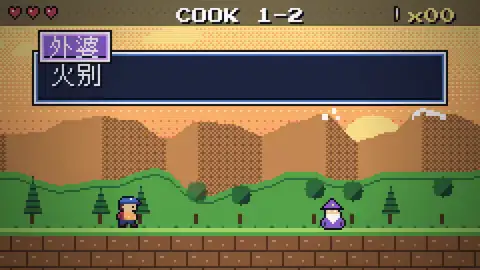<br><b>像素风</b> · 厨房闯关记<br><sub>游戏 HUD、对话框、宝箱、昼夜变化</sub><br><sub><a href="skills/shiwu-huajing/references/styles/pixel.md">风格卡</a> · <a href="skills/shiwu-huajing/examples/films/pixel-厨房闯关记/">源码</a></sub></td>
</tr>
</table>

不知道选哪种：看[选风格](skills/shiwu-huajing/references/styles/00-选风格.md)，或者直接说主题，让 AI 给你推荐两三种。

## 怎么用

直接说你现在的情况：

- **点名风格**：「用像素风做一个 15 秒的片头，主题是新手第一次下厨，横屏」。
- **不知道用哪种风格**：说主题和给谁看，它给 2～3 个候选，各一句理由。
- **抖音竖屏**：说「竖屏 9:16」，综艺花字、知识科普贴纸最适合。
- **有品牌名、logo、照片**：一起发给它，它会放进片子里；没有品牌名它会编一个，不会用别人的。
- **做完不满意**：说哪一秒哪里不对（最好截图），它对照风格卡改。

它会先跟你确认主题、时长、横竖屏，再交节拍表，然后才写代码。交付时给 MP4、源码文件夹和一段说明。

## 它和直接让 AI 做动画有什么不一样

直接让 AI「做个赛博朋克风动画」，通常得到的是几个元素飘在空白里：一个雷达、两个小面板，像屏保，不像电影里的指挥舱。差的不是代码能力，是不知道这种风格靠什么成立。

- **风格卡是对照成片总结的**：每张卡第一节就是「最容易做成不像的原因」，接着是画面版式表（每块放在哪、放什么）、10 秒时间表（每一秒发生什么、配什么声音）、配色、字体。
- **有现成的脚手架**：逐帧渲染、确定性导出，画面和声音严格对齐，导出的 MP4 每次都一样。
- **有踩坑清单和自查清单**：做样片时真实遇到的坑（比如 Chrome 不画长度为 0 的圆头线、元球中心会出黑点）都写进去了，做完按清单抽帧检查。
- **分了能力档**：强模型读全卡自由发挥，一般模型只走「最小可行做法」，宁可少而干净。

## skill 里有什么

```
skills/shiwu-huajing/
├── SKILL.md                 入口：流程、能力档位、文件地图、底线
├── references/
│   ├── 00-工作流程.md        问清楚 → 选风格 → 节拍表 → 静帧 → 动画 → 配乐 → 自查
│   ├── 01-通用手艺.md        缓动、错峰、预备回弹、排版、配色
│   ├── 02-渲染与导出.md      逐帧渲染、导出 MP4、代码合成配乐
│   ├── 03-踩坑清单.md
│   ├── 04-自查与评审.md
│   ├── 05-一般模型怎么做.md
│   ├── 06-版权与素材.md      字体、图片、音乐、商标、AI 生成标识
│   └── styles/              15 张风格卡 + 选风格
├── starter/                 脚手架：改 film.js 就是做片子，双击启动器预览导出
└── examples/                15 支样片源码 + 像素 / 扁平 / 综艺花字零件库
```

## 方法来源与维护

风格卡对照开源项目 [mg-styles-15](https://github.com/Vincentwei1021/mg-styles-15)（作者 Vincentwei1021，MIT 许可）的 15 支样片学习总结：学它每种风格的版式、零件、节奏和质感，用自己的话写成卡片；样片的主题、文案、角色、构图、配乐全部重新做。感谢原作者公开了成片、提示词和完整源码。

维护记录在 [进度记录.md](进度记录.md)：每一步做了什么、哪里被否定、为什么这么改。`legacy/` 里是两条已经放弃的路线（v0.3 改原片配置的模板版、只写镜头表的创作版），留作对照。

## 许可

[MIT](LICENSE)：可以用、改、商用、再分发，保留版权声明即可。第三方内容保留各自许可：自带字体为 SIL OFL 1.1，拼贴样片的图片为 CC0，逐项见 [NOTICE.md](NOTICE.md)。用它做出来的片子，本项目不主张任何权利；发布前请看[版权与素材](skills/shiwu-huajing/references/06-版权与素材.md)。以上不构成法律意见。
