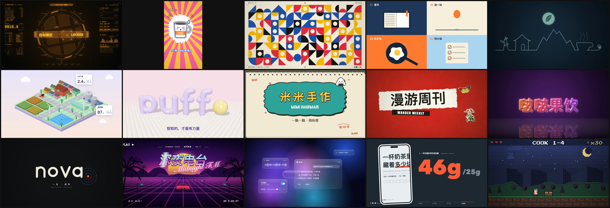

<div align="center">

# 十五画境 · Motion Palette 15

**一本给 AI 看的 MG 动画手艺书：15 种动态设计风格，教 AI 按你的主题写出原创动画短片。**

   [](LICENSE)



<sub>上图 15 帧都出自用本 skill 做的样片：画面、动画、配乐全部是代码写的，没有用生图或生视频模型。</sub>

</div>

## 这是什么

你对 AI 说「用十五画境做一个 10 秒的赛博 HUD 片头，主题是寻找走丢的猫」，它会：

1. 先读这种风格的「门道卡」：一眼认出它靠什么、版式怎么摆、10 秒的节奏怎么排、最容易做成「不像」的原因；
2. 按你的主题写节拍表，再写画面代码（Canvas / SVG / Three.js）和配乐代码；
3. 用自带的脚手架逐帧渲染，导出带声音的 MP4，最后按自查清单检查一遍。

**它不是模板库。** 每次做出来都是新片子：风格照卡学到位，主体、文案、角色、构图、配乐都是新的。模型越强做得越好；一般的模型（豆包、DeepSeek 等）照着「一般模型怎么做」走，也能做到像样。

## 15 种风格

| # | 风格 | 样片 | 一句话 |
|---|---|---|---|
| 1 | 赛博 HUD | 寻猫雷达 | 指挥舱屏幕铺满信息，只有一个焦点，全部为「锁定」那一下蓄力 |
| 2 | 综艺花字（竖屏） | 周一早上 | 贴纸描边大字、放射背景、表情包式的吐槽 |
| 3 | 包豪斯 | 形意周 | 几何色块出血、印刷标记、图案爆发 |
| 4 | 扁平矢量 | 早一点 | 无描边色块、一个小元素串起所有转场 |
| 5 | 线条一笔画 | 山间茶事 | 一根线不断开，画出一整个故事 |
| 6 | 等轴 2.5D | 一亩田 | 沙盘升起、白模生长、颜色从中心铺开 |
| 7 | 3D 软萌 | 泡芙工作室 | 充气字落地回弹、珠子地面起波纹 |
| 8 | 逐帧手绘 | 米米手作 | 每两帧抖一次的线条、一笔一笔写出的字 |
| 9 | 拼贴 | 漫游周刊 | 网点剪报、沿虚线剪开、撕纸转场 |
| 10 | 液态 | 啵啵果饮 | 水滴溅开、分裂、融合成果冻字 |
| 11 | 形变 | nova. | 点变线、线变圈、圈变字母 |
| 12 | 复古霓虹 VHS | 深夜电台 | 录像带界面、霓虹网格、条纹太阳、铬金大字 |
| 13 | 弥散玻璃 | Muse | 层叠毛玻璃卡片、液态玻璃胶囊放大 |
| 14 | 知识科普贴纸 | 一杯奶茶多少糖 | 粗标题、数据逐格填满、画中画结论 |
| 15 | 像素风 | 厨房闯关记 | 游戏 HUD、对话框、宝箱、昼夜变化 |

每支样片的源码在 [`skill/shiwu-huajing/examples/films/`](skill/shiwu-huajing/examples/films/)，每张风格卡在 [`skill/shiwu-huajing/references/styles/`](skill/shiwu-huajing/references/styles/)。45 秒的总览视频在 [Releases](https://github.com/liuhaisi2026212-maker/motion-palette-15/releases) 里。

## 快速开始

### 1. 安装

到 [Releases](https://github.com/liuhaisi2026212-maker/motion-palette-15/releases) 下载最新的 `shiwu-huajing-*.zip`，解压出 `shiwu-huajing` 文件夹，放到你的 Agent 的技能目录：

| 平台 | 放到 |
|---|---|
| Claude Code | `~/.claude/skills/shiwu-huajing/` |
| Codex | `~/.codex/skills/shiwu-huajing/` |
| Cursor、Trae 等能读规则文件的 Agent | 放进项目里，让它先读 `SKILL.md` |
| 只能聊天的平台（豆包、DeepSeek、Kimi 网页版） | 上传或粘贴 `SKILL.md`、`references/05-一般模型怎么做.md` 和你要的那张风格卡 |

### 2. 说你要什么

> 用十五画境做一个 15 秒的像素风片头，主题是「新手第一次下厨」，横屏。

AI 会先跟你确认主题、时长、横竖屏，再给出节拍表和成片。

### 3. 自己预览和导出

- 双击 `starter/启动.command`（Mac）或 `starter/启动.bat`（Windows），浏览器里预览，点「导出 MP4」。需要 Chrome 或 Edge，以及 Node.js 或 Python 其中之一。
- 命令行：在 `starter/` 里 `npm install`，然后 `npm run sheet`（抽帧总览）、`npm run render`（导出 MP4，需要 ffmpeg）。

## skill 里有什么

```
shiwu-huajing/
├── SKILL.md                 入口：流程、能力档位、文件地图、底线
├── references/
│   ├── 00-工作流程.md        问清楚 → 选风格 → 节拍表 → 静帧 → 动画 → 配乐 → 自查
│   ├── 01-通用手艺.md        缓动、错峰、预备回弹、排版、配色
│   ├── 02-渲染与导出.md      逐帧渲染契约、导出 MP4、代码合成配乐
│   ├── 03-踩坑清单.md        做样片时真实踩过的坑
│   ├── 04-自查与评审.md      抽帧检查、打分
│   ├── 05-一般模型怎么做.md   给能力一般的模型的稳妥做法
│   ├── 06-版权与素材.md      字体、图片、音乐、商标、AI 标识
│   └── styles/              15 张风格门道卡 + 选风格索引
├── starter/                 脚手架：改 film.js 就是做片子
├── examples/                15 支样片源码 + 像素 / 扁平 / 综艺花字零件库
└── LICENSE · NOTICE.md · licenses/
```

每张风格卡都包含：一眼认出它、适合 / 不适合、**最容易做成「不像」的原因**、画面版式、时间表、配色、字体、技术路线、最小可行做法、进阶做法、常见做砸、配乐。

## 仓库结构

| 目录 | 内容 |
|---|---|
| `skill/shiwu-huajing/` | **主线**：手艺书 skill 本体 |
| `样片/手艺书版/` | 样片源码（MP4 不进仓库，在 Releases 里） |
| `docs/` | README 用的图 |
| `work/`、`studio/` | 历史版本：v0.3 模板版（改原片配置出片）、创作版零件库 |
| `进度记录.md` | 每一步做了什么、为什么这么改 |

## 版本

| 版本 | 内容 |
|---|---|
| v0.5 | 15 种风格各一支原创样片，风格卡全部对照原版补「最容易做成不像的原因」；补齐许可和来源说明 |
| v0.4 | 改为手艺书路线：15 张风格门道卡 + 通用手艺 + 脚手架 |
| v0.3 | 模板版：基于原片改文字和配色出片（14/15 可用）。路线已放弃，保留在 `work/` |

## 许可与致谢

- 本项目按 [MIT 许可](LICENSE) 发布：可以用、改、商用、再分发，保留版权声明即可。
- 15 张风格卡是对照开源项目 **[mg-styles-15](https://github.com/Vincentwei1021/mg-styles-15)**（作者 Vincentwei1021，MIT 许可）的 15 支样片学习总结的。感谢原作者把成片、提示词和完整源码全部公开。
- 自带字体为 SIL OFL 1.1，拼贴样片里的图片为 CC0 / 公有领域，代码库各自保留原许可。逐项来源见 [NOTICE.md](NOTICE.md)，许可原文在 [`licenses/`](licenses/)。
- 用本 skill 做出来的片子，本项目不主张任何权利。发布前请看 [版权与素材](skill/shiwu-huajing/references/06-版权与素材.md)：字体能不能商用、图片和音乐从哪来、别用别人的商标、发布时按规定标注 AI 生成。

> 以上说明是整理来源和使用规范用的，不构成法律意见。
